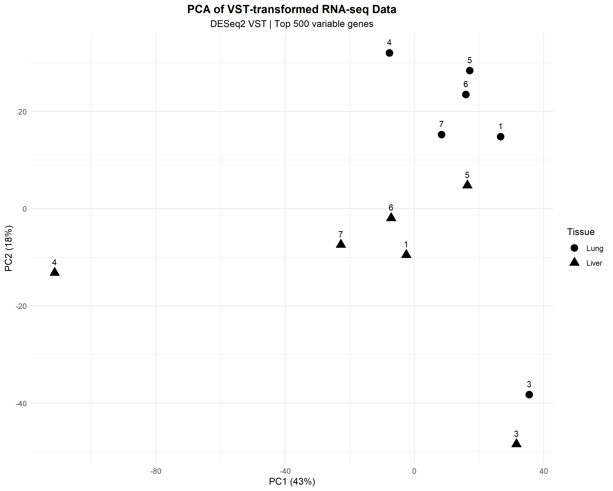
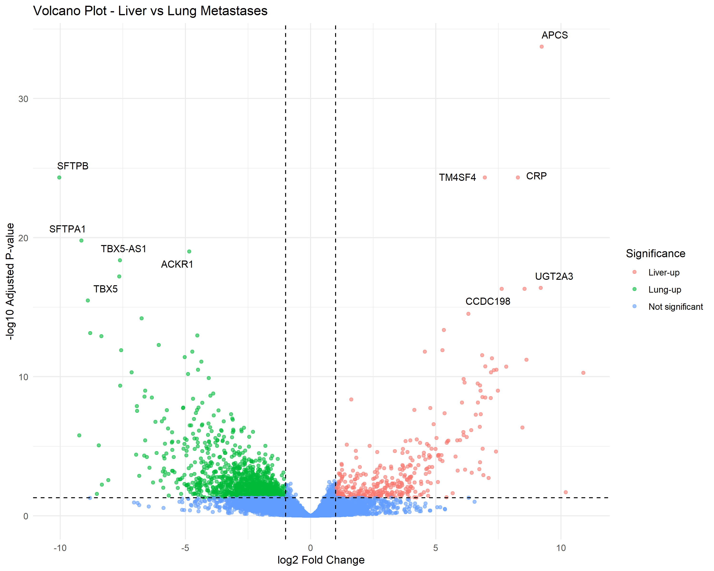
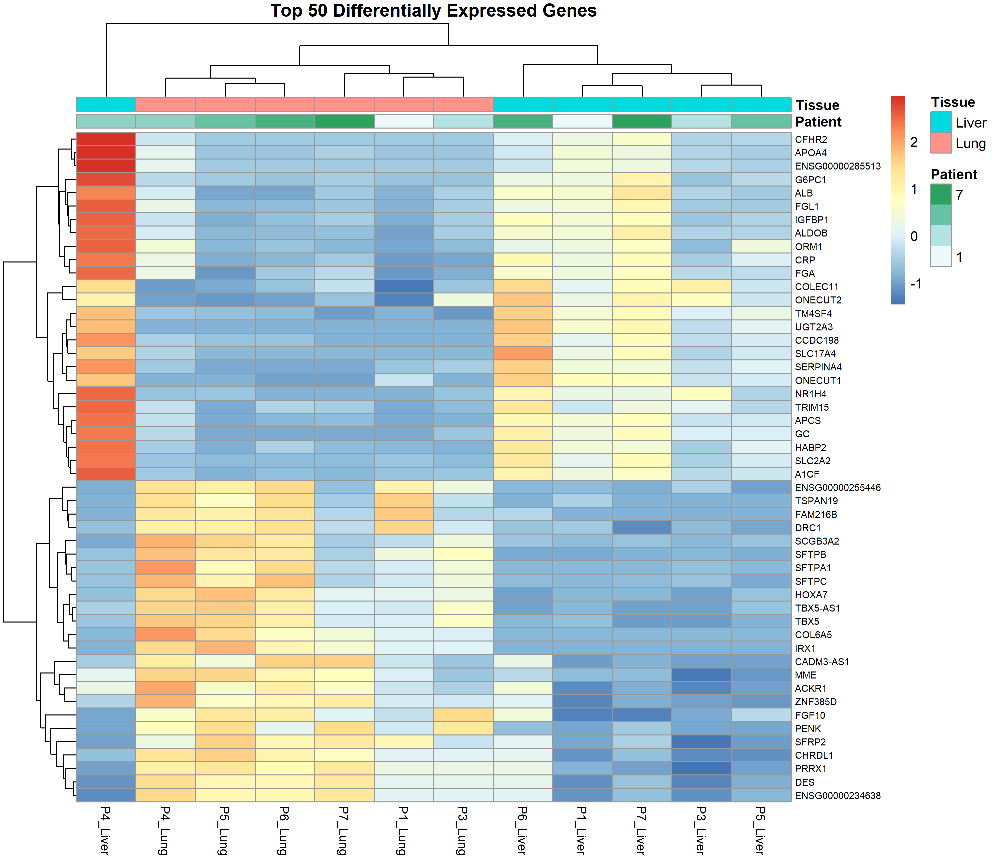
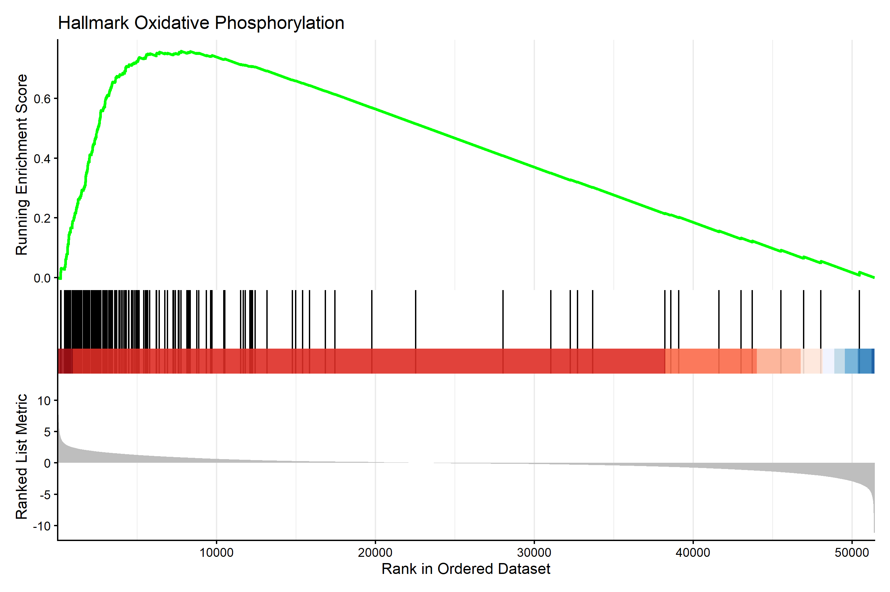
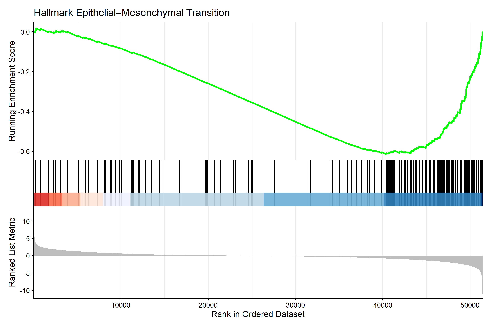
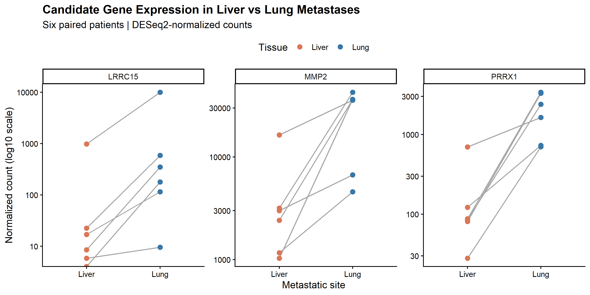

# RNA-Seq Differential Expression Analysis

## Overview

This project investigates gene-expression differences between liver and lung metastases of estrogen receptor-positive (ER+) breast cancer using RNA-seq data from the Gene Expression Omnibus (GEO).

The workflow combines Python-based data preparation and quality control with differential expression analysis and pathway enrichment in R.

## Research Question

Which genes and biological pathways differ between liver and lung metastases of ER-positive breast cancer?

## Dataset

- **GEO accession:** [GSE316391](https://www.ncbi.nlm.nih.gov/geo/query/acc.cgi?acc=GSE316391)
- **Organism:** *Homo sapiens*
- **Data type:** RNA-seq gene counts and clinical metadata
- **Comparison:** Liver metastases vs. lung metastases
- **Study design:** Paired analysis

The primary analysis included six patients with samples from both metastatic sites: Patients 1, 3, 4, 5, 6, and 7. Patient 2 was excluded from the paired comparison because a lung sample was unavailable. Technical replicates were collapsed before statistical testing.

## Methods

### 1. Data Preparation and Quality Control

Python was used to prepare the count matrix, map sample identifiers to clinical metadata, and perform exploratory quality-control analyses.

### 2. Differential Expression Analysis

Differential expression was performed using DESeq2 with the design:

```r
~ Patient + Tissue
```

The contrast was **Liver vs. Lung**, with Lung as the reference tissue.

- Positive log2 fold changes indicate higher expression in liver metastases.
- Negative log2 fold changes indicate higher expression in lung metastases.
- Genes with adjusted p-values (`padj`) below 0.05 were considered statistically significant.

### 3. Functional Enrichment

Functional analysis included:

- Gene Ontology Biological Process (GO BP) enrichment
- Gene Set Enrichment Analysis (GSEA) using MSigDB Hallmark gene sets
- Leading-edge gene analysis for selected pathways
- Paired expression visualization of candidate genes

GSEA used the DESeq2 Wald statistic to rank genes. Positive normalized enrichment scores (NES) indicate enrichment toward liver metastases; negative NES values indicate enrichment toward lung metastases.

## Key Results

### Differential Expression

- **1,767 genes** had `padj < 0.05`.
- **451 genes** had positive log2 fold changes and were higher in liver metastases.
- **1,316 genes** had negative log2 fold changes and were higher in lung metastases.

### Hallmark GSEA

A total of **41 Hallmark pathways** had adjusted p-values below 0.05.

Selected results included:

| Pathway | NES | Direction |
|---|---:|---|
| Oxidative Phosphorylation | +3.16 | Liver-enriched |
| MYC Targets V1 | +3.06 | Liver-enriched |
| mTORC1 Signaling | +2.56 | Liver-enriched |
| Epithelial–Mesenchymal Transition (EMT) | −2.21 | Lung-enriched |

Positive NES values indicate enrichment toward liver metastases, while negative NES values indicate enrichment toward lung metastases.

### Candidate Gene Analysis

Paired normalized-count comparisons were performed for three candidate genes:

- **PRRX1**
- **LRRC15**
- **MMP2**

All three genes had higher normalized counts in lung samples than in the corresponding liver samples for all six patients. This is a descriptive observation within the same dataset and is not independent validation of the differential-expression results.

The candidate-gene analysis should be interpreted as exploratory. Differences in cellular composition, including stromal and fibroblast content, may contribute to the observed expression patterns.

## Visualizations

### PCA of VST-Transformed Counts



### Differential Expression Volcano Plot



The volcano plot highlights genes using `padj < 0.05` and `|log2FC| > 1`.

### Heatmap of the Top 50 Differentially Expressed Genes



### Hallmark GSEA: Oxidative Phosphorylation



### Hallmark GSEA: EMT



### Paired Candidate-Gene Expression



## Output Files

- `Results/Differential_Expression/` — differential-expression result tables and volcano plot
- `Results/DESeq2/` — DESeq2 object, PCA, heatmap, and related outputs
- `Results/Enrichment/` — GSEA results, pathway plots, leading-edge gene tables, and candidate-gene summaries

Candidate-gene tables:

- `Candidate_Genes_paired_summary.csv`
- `Candidate_Genes_paired_results.csv`

## Limitations

- The paired analysis includes only six patients, limiting statistical power and generalizability.
- Differences in cell-type composition between metastatic samples may influence gene-expression and pathway-enrichment results.
- Enrichment results are exploratory and do not establish causation.
- Candidate genes selected from this dataset require independent validation in larger cohorts.

## ## Repository Structure

```text
RNA-Seq-Differential-Expression-Analysis/
├── Data/
│   ├── Raw/          # Source data (not tracked by Git)
│   └── Processed/    # Prepared analysis inputs
├── Results/
│   ├── DESeq2/
│   ├── Differential_Expression/
│   └── Enrichment/
├── SRC/
│   ├── 01_differential_expression.R
│   └── 03_gsea_hallmark.R
├── main.py
└── README.md
```

## Reproducibility

The project uses Python for data preparation and R for differential-expression and pathway-enrichment analyses.

The main analysis scripts are:

- `main.py` — Python-based data preparation.
- `SRC/01_differential_expression.R` — paired differential-expression analysis using DESeq2.
- `SRC/03_gsea_hallmark.R` — GSEA using MSigDB Hallmark gene sets.

Run the Python preparation workflow before running the R analysis scripts. The required raw input files must be available in `Data/Raw/`, and the processed count matrix and metadata must be available in `Data/Processed/`.

The R scripts can be executed from the project root in R or RStudio:

```r
source("SRC/01_differential_expression.R")
source("SRC/03_gsea_hallmark.R")
```

Raw input data are not included in the repository. The original dataset is available from [GEO: GSE316391](https://www.ncbi.nlm.nih.gov/geo/query/acc.cgi?acc=GSE316391).

## Acknowledgments

The RNA-seq data were obtained from the Gene Expression Omnibus study [GSE316391](https://www.ncbi.nlm.nih.gov/geo/query/acc.cgi?acc=GSE316391).

